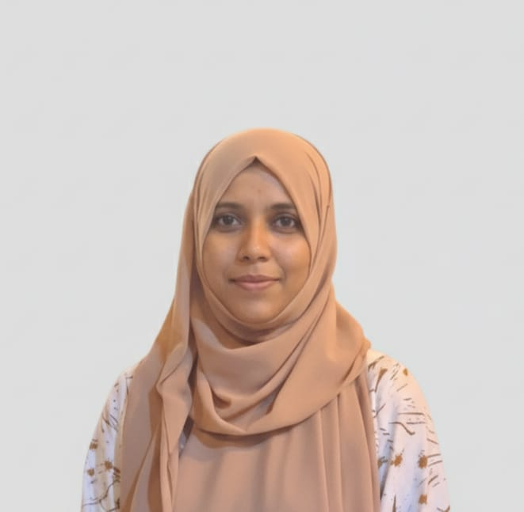

div align="center">

# Hi, I'm Rusmi Fathima

### Engineering Undergraduate · Full-Stack & AI Projects

Building practical web applications and exploring how AI can make them more useful.

[GitHub](https://github.com/alfrusmi-tech) · [My repositories](https://github.com/alfrusmi-tech?tab=repositories)

<!-- After uploading Assets/poster.png, remove the comment markers around this block.

  

For animation, change Assets/poster.png to Assets/output.gif.
-->

## About me

I'm an engineering undergraduate interested in full-stack development, applied AI, and DevOps. I learn by building projects, solving integration problems, and improving applications step by step.

- Building **GradLink**, a MERN job portal with CV analysis.
- Developing a **RAG Research Assistant** for asking questions about PDF documents.
- Working on **ExpiryGuard**, an inventory and expiry alert system.
- Exploring machine learning, retrieval-augmented generation, and multi-agent news verification.

## Projects

| Project | What I'm building | Technologies |
| :--- | :--- | :--- |
| [GradLink](https://github.com/alfrusmi-tech/GradLink_project) | A job portal connecting job seekers and recruiters, with CV analysis | React, Node.js, Express, MongoDB |
| RAG Research Assistant | A PDF question-answering tool with retrieved source references | Python, Streamlit, LangChain, Gemini, ChromaDB |
| ExpiryGuard | Inventory management with stock and expiry alerts | React, Spring Boot, PostgreSQL, Docker |
| TruthLens | A group project for explainable news and article verification | NLP, evidence retrieval, multi-agent AI |

## Technologies I'm working with

| Area | Technologies |
| :--- | :--- |
| Languages | JavaScript, Python, Java |
| Frontend | React, HTML, CSS, Tailwind CSS |
| Backend | Node.js, Express, Spring Boot |
| Databases | MongoDB, PostgreSQL |
| AI & data | LangChain, Gemini API, ChromaDB, scikit-learn |
| Tools & deployment | Git, GitHub, Docker, GitHub Actions, VS Code, Vercel, Railway |

## Currently learning

- Improving retrieval quality and evaluation in RAG applications.
- Building reliable APIs and connecting frontend and backend services.
- Testing, containerization, and continuous integration.
- Evaluating machine learning models while avoiding data leakage.

---

**Explore my repositories to see my projects and learning progress.**

<!-- Optional additions:
1. Add only your real LinkedIn, portfolio, and public contact links above.
2. Link the remaining project titles once you confirm their public repository URLs.
3. Add GitHub analytics cards only after testing their third-party image URLs.
4. Update this README as your skills and project status change.
-->

<!--
**alfrusmi-tech/alfrusmi-tech** is a ✨ _special_ ✨ repository because its `README.md` (this file) appears on your GitHub profile.

Here are some ideas to get you started:

- 🔭 I’m currently working on ...
- 🌱 I’m currently learning ...
- 👯 I’m looking to collaborate on ...
- 🤔 I’m looking for help with ...
- 💬 Ask me about ...
- 📫 How to reach me: ...
- 😄 Pronouns: ...
- ⚡ Fun fact: ...
-->
